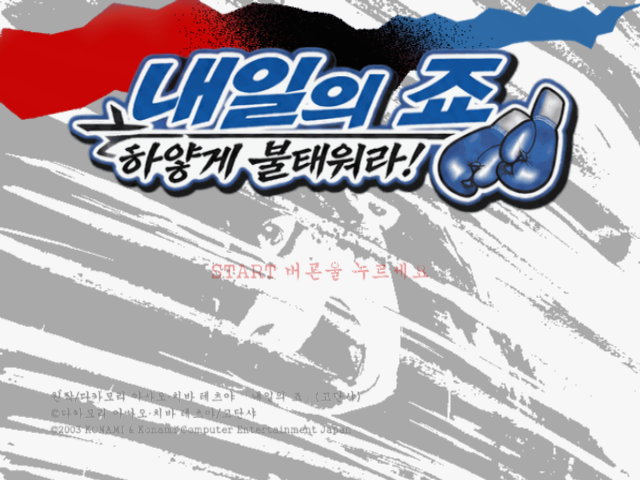
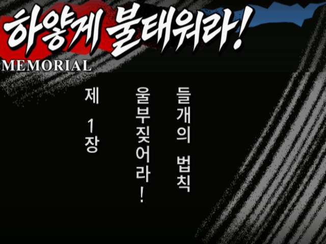
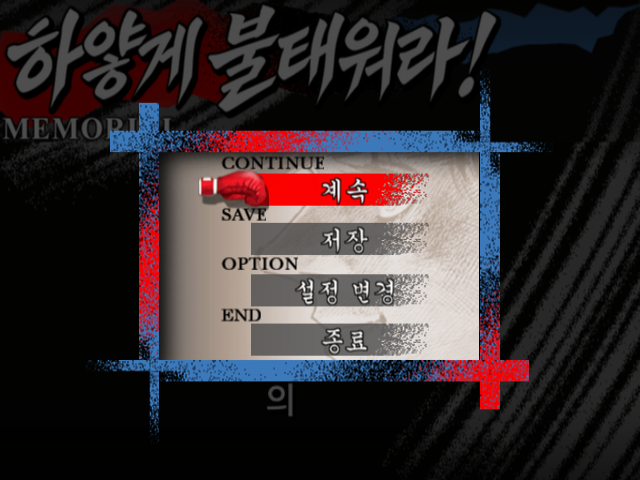
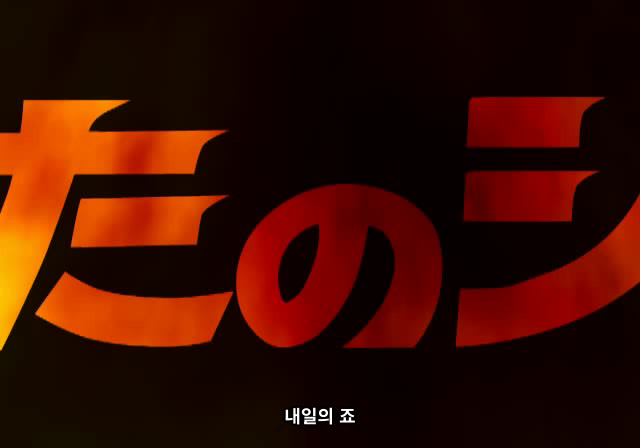

# 내일의 죠 — 하얗게 불태워라! 한국어 패치

**PlayStation 2 · 일본판 SLPM-65441 · v0.95 TEST**

『あしたのジョー ～まっ白に燃え尽きろ！～』의 대사·시스템 문구·UI와 영상 자막을 한국어로 바꿉니다. 원작의 붓글씨, 색, 종이 질감과 인물 삽화를 살리고 반각 띄어쓰기를 적용했습니다.

**[v0.95 다운로드](https://github.com/OldManCraveGuitars-bit/PS2-Ashita-no-Joe-Masshiro-ni-Moe-Tsukiro-Kr/releases/tag/v0.95)** · [수정 내역](CHANGELOG.md) · [SHA-256](docs/HASHES.md) · [검증 범위](docs/VALIDATION.md)

## 패치 적용

1. 릴리스에서 **`Ashita-no-Joe-Kr-v0.95.zip`**을 받아 압축을 모두 풉니다.
2. **`Ashita-no-Joe-Kr-Patcher-v0.95.exe`**를 실행합니다. Python 설치는 필요 없습니다.
3. 본인이 보유한 일본판 원본 ISO와 새 한글 ISO의 저장 위치를 선택합니다.
4. **한글 패치 적용**을 누릅니다. 원본과 패치를 검사하고, 생성된 ISO의 SHA-256까지 확인합니다.
5. 완성된 `Ashita-no-Joe-Kr-v0.95.iso`를 새로 부팅합니다.

EXE, `.xdelta`, `patch-manifest.json`은 같은 폴더에 두세요. 원본 ISO를 덮어쓰지 않으며, 이미 존재하는 출력 파일도 덮어쓰지 않습니다. 출력 드라이브에 약 2.5GB의 빈 공간이 필요합니다.

| 대상 | 값 |
| --- | --- |
| 기종 | PlayStation 2 |
| 원본 | Ashita no Joe - Masshiro ni Moe Tsukiro! (Japan) |
| 제품 번호 | SLPM-65441 |
| 원본 ISO 크기 | 2,196,439,040 bytes |
| 패치 결과 크기 | 2,527,619,072 bytes |
| 적용 도구 | Windows용 전용 EXE |

원본 ISO의 SHA-256:

```text
7a03d9515210cdf97d9d96cbd4cfa06805b5807fbc5259f3c9e93be28b7245b8
```

v0.95 적용 결과 ISO의 SHA-256:

```text
8371802c869787c82fa30e34bb7f02629d35a9d288d76ad162b6c9f7644920e7
```

배포 ZIP·EXE·차분 패치의 해시는 [해시 목록](docs/HASHES.md)과 릴리스의 `SHA256SUMS.txt`에서 확인할 수 있습니다.

## 한글화 범위

| 항목 | 반영 내용 |
| --- | --- |
| 스토리·시스템 | 대사 3,289개, 시스템 문구 554개 |
| 제목 | 장 시작 제목 14개, 챕터 선택 제목 143개 |
| 이미지 | 메인·UI·경기 표시 등 617개 |
| 대전 소개 | 소개 문구 325개, 별명 64개 |
| 경기·교본 | 제1~15라운드 표시, 추가 튜토리얼 UI 24개 |
| 영상 | 51개 영상에 한글 자막 318개, 27개 영상은 원본 유지 |
| 종소리 | 긴 울림·짧은 반복 효과의 글씨를 ‘땡―!’, ‘땡!’으로 변경 |

음성은 원본 ADX 데이터를 유지합니다. 일반 배경·인물 그림은 보존하고, 기본 가로쓰기와 화면별로 필요한 세로쓰기를 구분했습니다. 장 시작의 세로 제목은 왼쪽 열부터 읽습니다.

## 주요 수정

- 메인과 각종 UI의 원작 붓글씨·기울기·테두리·색을 살렸습니다.
- 설정·저장·불러오기·경기 규칙의 글자 크기, 기준선, 여백과 정렬을 다듬었습니다.
- ㅇ 안팎의 검은색·흰색 테두리 누락, 일본어 잔상과 색 단차를 보완했습니다.
- 경기 규칙과 재대결·종료의 표시 영역을 원본과 대조하여 글자 잘림과 다른 행의 획이 섞이는 문제를 고쳤습니다.
- 대사 끝 문장부호가 혼자 다음 줄로 내려가지 않도록 줄바꿈을 보완했습니다.
- 저장 목록의 긴 제목을 조정하고 반각 공백을 적용해, 리키이시전 뒤 저장 메뉴에서 발생하던 프리징과 글자 넘침을 수정했습니다.
- 오프닝의 큰 제목 구간에 ‘내일의 죠’ 자막을 추가했습니다.
- 종소리의 빨강·검정 글씨 효과를 한글화하고 원래 연출 타이밍과 소리는 유지했습니다.

자세한 내용은 [CHANGELOG](CHANGELOG.md)를 참고하세요.

## 스크린샷

| 메인 메뉴 | 스토리 대사 |
| --- | --- |
|  |  |

| 장 시작 제목 | 경기 규칙 |
| --- | --- |
|  |  |

| 저장·불러오기 | 스토리 메뉴 |
| --- | --- |
|  |  |

오프닝 자막 — 최종 인코딩 영상에서 추출한 프레임입니다.



### UI 테두리·배치와 종소리 효과

최종 게임 팔레트로 변환한 이미지입니다. 실제 플레이 중 화면과 구분한 식자 검수 자료입니다.


## 검증과 참고 사항

전용 EXE로 원본 ISO에 패치를 적용하고 결과 해시를 검사합니다. 게임 자료의 구조·포인터·글리프·텍스처·원본 음성과 영상 프레임 수를 대조했습니다. PCSX2에서 타이틀·메뉴·표본 대사 진행과 저장·덮어쓰기·재부팅 후 불러오기를 확인한 코드와 데이터를 사용합니다.

**전편 플레이, 모든 음성의 직접 청취, PS2 실기 실행 검증은 완료되지 않아 테스트판으로 배포합니다.** 구체적인 확인 범위와 스크린샷의 출처는 [검증 문서](docs/VALIDATION.md)에 기록했습니다.

처음 적용한 뒤에는 새로 부팅하세요. 이전 중간 저장 상태(savestate)는 예전 코드와 이미지를 복원할 수 있습니다. 일반 메모리 카드의 세이브 형식은 변경하지 않았습니다.

## 도구와 출처

- [전용 EXE 패처 소스](patcher/patcher.py): 원본·차분 패치·출력의 SHA-256 검사, 별도 파일 생성, 기존 파일 덮어쓰기 방지.
- [패처 빌드 방법](patcher/README.md)
- 차분 처리: [Xdelta 3.2.1](https://github.com/jmacd/xdelta/releases/tag/v3.2.1), Joshua MacDonald — Apache-2.0.
- 실행 환경: CPython / Tk. 관련 고지문은 [licenses](licenses)에 있습니다.
- 한글 식자: 설치된 궁서, Noto Sans KR, 나눔붓글씨, 마포홍대프리덤을 용도에 맞게 사용했습니다. 글꼴 파일은 이 저장소에 포함하지 않습니다.

패처 코드는 [MIT License](LICENSE)입니다. 게임·원작·기존 자산의 권리는 각 권리자에게 있습니다. 이 저장소와 릴리스는 원본 게임 ISO·BIOS를 포함하지 않습니다.
