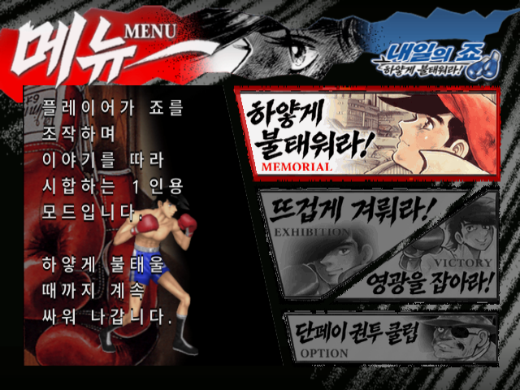
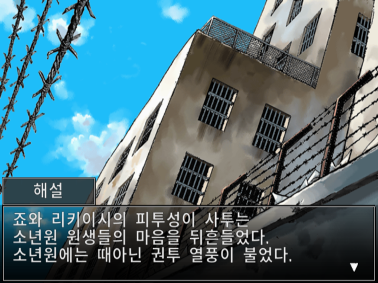
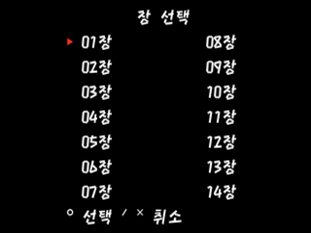
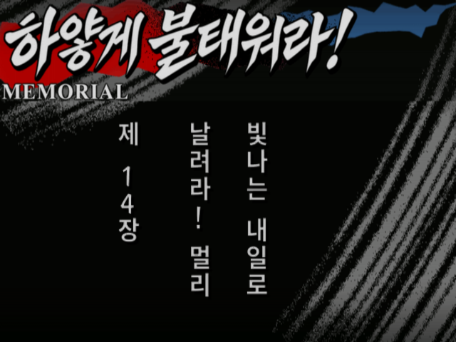
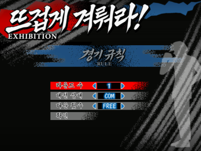
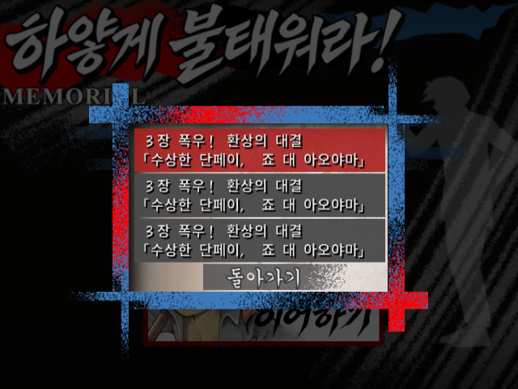
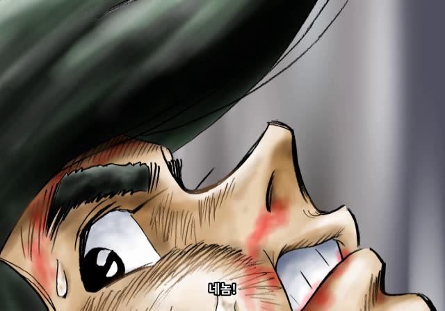
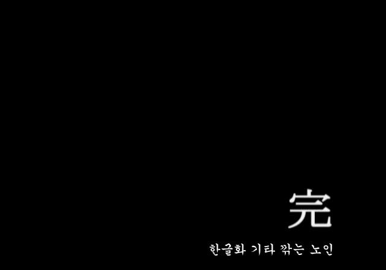
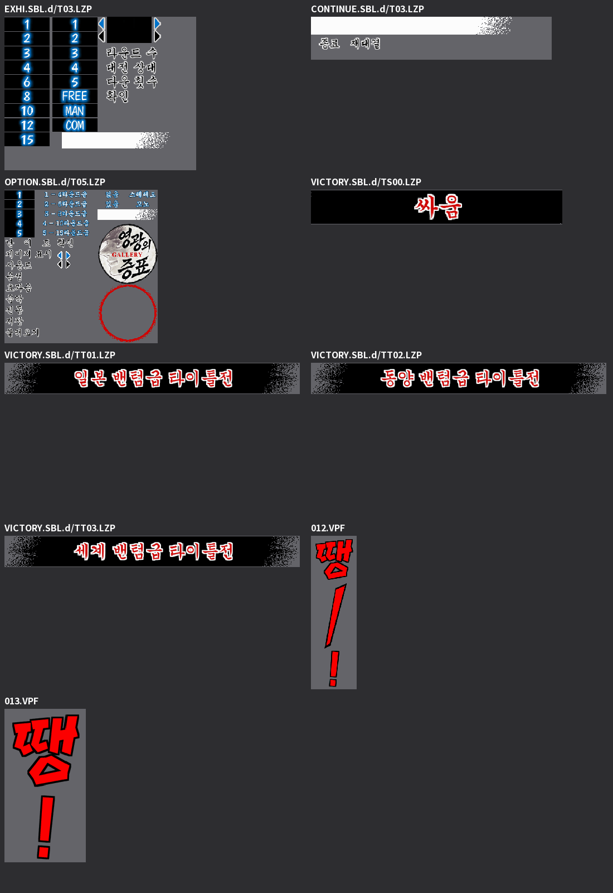

# 내일의 죠 — 하얗게 불태워라!

**PS2 · 비공식 한글화 정식버전 v1.1 · 일본판 SLPM-65441**

**한글화: 기타 깎는 노인**

『あしたのジョー ～まっ白に燃え尽きろ！～』의 대사·시스템 문구·메인/UI와 영상 자막을 한국어로 옮긴 비공식 한글 패치입니다. 원작의 붓글씨, 색, 종이 질감과 인물 삽화를 살리고 반각 띄어쓰기를 적용했습니다.

**[v1.1 패치 다운로드](https://github.com/OldManCraveGuitars-bit/PS2-Ashita-no-Joe-Masshiro-ni-Moe-Tsukiro-Kr/releases/download/v1.1/Ashita-no-Joe-Kr-v1.1.zip)** · **[전체 챕터 개방 세이브](https://github.com/OldManCraveGuitars-bit/PS2-Ashita-no-Joe-Masshiro-ni-Moe-Tsukiro-Kr/releases/download/v1.1/Ashita-no-Joe-Kr-All-Chapters-v1.1.zip)** · [수정 내역](CHANGELOG.md) · [SHA-256](docs/HASHES.md)

## v1.1에서 추가·보완한 내용

- **스토리 중 SELECT로 제1~14장 시작 지점 이동**: 방향키로 선택하고 ○로 이동, × 또는 SELECT로 취소합니다.
- **전체 챕터 개방 세이브 별도 제공**: 원래 챕터 선택의 143개 항목을 개방했습니다. PCSX2 계열용 `.ps2` 카드와 기존 카드에 가져오는 `.psu`를 함께 제공합니다.
- **말투 재검수**: 리키이시의 식당 종업원 대사는 반말로, 회장·요코에게 쓰는 존대는 유지하는 등 대화 상대와 문맥에 따라 보완했습니다.
- **긴 제목·시합 조건의 잘림 보완**, 챕터·저장 제목 16곳의 `(1)`, `(2)`에서 괄호를 제거하고 숫자는 유지했습니다.
- **보이스 자막 누락·오인식 보완**: 카를로스 장면과 죠의 호칭 등을 보완하고, 곤도 장면의 비명을 ‘울프!’로 잘못 넣었던 자막을 삭제했습니다.
- **엔딩 마지막 표기**: 원래 일본어 크레딧·삽화·完을 유지하고 그 아래에 **‘한글화 기타 깎는 노인’** 한 줄만 추가했습니다.

v0.95의 원작풍 UI, 반각 띄어쓰기, 라운드·종소리 한글화와 저장 목록 프리징 수정도 모두 포함합니다.

## 패치 적용 방법

1. [**`Ashita-no-Joe-Kr-v1.1.zip`**](https://github.com/OldManCraveGuitars-bit/PS2-Ashita-no-Joe-Masshiro-ni-Moe-Tsukiro-Kr/releases/download/v1.1/Ashita-no-Joe-Kr-v1.1.zip)을 받아 압축을 모두 풉니다.
2. Windows에서 **`Ashita-no-Joe-Kr-Patcher-v1.1.exe`**를 실행합니다. Python 설치는 필요 없습니다.
3. 일본판 원본 ISO와 새 한글 ISO의 저장 위치를 선택하고 **한글 패치 적용**을 누릅니다.
4. 완료 메시지를 확인한 뒤 생성된 **`Ashita-no-Joe-Kr-v1.1.iso`**를 새로 부팅합니다.

EXE·`.xdelta`·`patch-manifest.json`은 같은 폴더에 두세요. 패처가 원본·패치·결과의 SHA-256을 검사하고 별도 ISO를 만듭니다. 출력 ISO용으로 약 3GB의 여유 공간이 필요하며, 다운로드와 압축 해제 공간은 별도입니다. Android 게임기에서는 PC에서 패치한 ISO를 복사해 실행하세요.

v0.95를 사용 중이더라도 **일본판 원본 ISO에서 다시 패치**하세요. 처음 실행할 때는 이전 savestate의 자동 불러오기를 끄고 새로 부팅하세요. 일반 게임 내 메모리카드 세이브 형식은 유지합니다.

| 대상 | 값 |
| --- | --- |
| 기종 / 원본 | PlayStation 2 / 일본판 SLPM-65441 |
| 원본 ISO 크기 | 2,196,439,040 bytes |
| 패치 결과 크기 | 2,527,619,072 bytes |
| 적용 도구 | Windows x64용 전용 EXE |
| 배포 방식 | 원본 ISO가 필요한 차분 패치 |

일본판 원본 ISO SHA-256:

```text
7a03d9515210cdf97d9d96cbd4cfa06805b5807fbc5259f3c9e93be28b7245b8
```

v1.1 결과 ISO SHA-256:

```text
32ae998430c4435d424479f417d6a4e57b9f624fcc0ca6741fd979888b0aaf30
```

ZIP·EXE·차분 패치·세이브의 해시는 [해시 목록](docs/HASHES.md)과 릴리스의 `SHA256SUMS.txt`에서 확인할 수 있습니다. **Code → Download ZIP 대신 릴리스의 배포 ZIP**을 받으세요.

## SELECT 장 이동 사용법

| 입력 / 상황 | 동작 |
| --- | --- |
| 일반 스토리 대사 화면에서 SELECT | 제1~14장 시작 지점 목록 열기 |
| 방향키 | 이동할 장 선택 |
| ○ | 선택한 장 처음으로 이동 |
| × 또는 SELECT | 취소하고 현재 대사로 복귀 |
| 전투·영상·장면 전환·기존 일시정지/저장 창 | 장 이동 비활성화 |

이동 전 진행은 자동 저장되지 않습니다. 필요한 진행은 먼저 게임 안에서 저장하세요. 기존 일시정지 메뉴가 열려 있으면 ‘계속’으로 대사 화면에 돌아온 뒤 SELECT를 누르세요. RetroArch 핫키와 겹치는 경우 PS2의 SELECT 입력이 게임에 전달되는지 확인하세요.

새 SELECT 메뉴는 **14개 장의 시작 지점**을 고르는 기능입니다. 원래 챕터 메뉴의 **143개 세부 항목 개방**은 별도 세이브가 담당합니다. SELECT 기능을 쓰는 데 개방 세이브가 필수는 아닙니다.

## 전체 챕터 개방 세이브

[**별도 세이브 ZIP 다운로드**](https://github.com/OldManCraveGuitars-bit/PS2-Ashita-no-Joe-Masshiro-ni-Moe-Tsukiro-Kr/releases/download/v1.1/Ashita-no-Joe-Kr-All-Chapters-v1.1.zip) · [기기별 적용 안내](docs/SAVE-GUIDE.md)

`.ps2`는 별도 메모리카드로 연결하고, `.psu`는 mymc/mymc++ 등으로 기존 카드에 가져옵니다. **기존 카드를 먼저 백업하세요.** 카드 전체 교체와 같은 게임 세이브 가져오기는 기존 진행 데이터에 영향을 줍니다. 패치 ZIP의 `saves` 폴더에도 같은 파일을 넣었습니다.

이전에 연결했던 RetroArch/LRPS2 게임기의 기존 카드 방식에서는 다음 경로를 사용합니다. 시스템/BIOS 경로를 바꿨거나 다른 코어·게임별 카드 설정을 쓴다면 [적용 안내](docs/SAVE-GUIDE.md)를 먼저 확인하세요.

```text
내부 저장소/RetroArch/system/pcsx2/memcards/Mcd001.ps2
```

## 한글화 범위

| 항목 | 반영 내용 |
| --- | --- |
| 스토리 / 시스템 | 대사 3,289개 / 시스템 문구 554개 |
| 제목 | 장 시작 14개 / 챕터 선택 143개 |
| 이미지 | 메인·UI·경기 표시 등 617개 |
| 대전 소개 | 소개 문구 325개 / 별명 64개 |
| 경기·교본 | 제1~15라운드 표시 / 추가 튜토리얼 UI 24개 |
| 영상 자막 | 52개 영상, 총 337개 항목: 음성·노래 335개 + 엔딩 표기 2개 |
| 원본 유지 영상 | 26개 |
| 종소리 | 원래 빨강·검정 연출과 소리를 유지한 ‘땡―!’, ‘땡!’ |

원본 ADX 음성, 영상 프레임 수·화면 비율과 일반 배경·인물 삽화를 보존합니다. 장 시작의 세로 제목은 왼쪽 열부터 읽습니다. 엔딩 제작진 크레딧 전체를 번역한 버전은 아닙니다.

## 스크린샷

| 메인 메뉴 | 스토리 대사 |
| --- | --- |
|  |  |

| 새 SELECT 장 이동 | 이동 후 제14장 시작 |
| --- | --- |
|  |  |

| 경기 규칙 | 저장·불러오기 |
| --- | --- |
|  |  |

| 종이 메뉴 | 보이스 자막 보완 — 최종 영상 프레임 |
| --- | --- |
|  |  |

오프닝 제목 자막과 엔딩 마지막 표기 — 최종 영상에서 추출한 프레임입니다.

| 오프닝 | 엔딩 표기 |
| --- | --- |
|  |  |

최종 게임 팔레트의 UI·종소리 식자 검수 이미지입니다.



기본 화면에는 자산이 유지된 기존 검수 실행 화면이 포함됩니다. 새 장 이동 화면은 배포와 동일한 자료의 PC 실행에서 촬영했으며 입력·장면 준비에 디버거를 사용했습니다. 영상 프레임과 식자 검수 이미지는 실제 플레이 화면과 구분했습니다. [스크린샷 출처와 검증 범위](docs/VALIDATION.md)

## 검증 범위와 참고 사항

v1.1은 정식 배포 릴리스입니다. 정식 배포 표시는 전편·모든 기기에서의 무결점 동작을 보증한다는 뜻은 아닙니다.

텍스트·표시 범위·포인터·폰트·이미지·영상 구조와 원본 음성을 검사했습니다. 장 시작 14곳, 반복 이동 19회, 장 이동 코드 39개 실행 사례를 검사하고 취소 및 전투·저장 창 차단을 확인했습니다. 전용 EXE의 실제 원본→패치→결과 ISO 적용 검사도 수행합니다.

전편 플레이, 모든 음성 직접 청취, PS2 실기와 모든 에뮬레이터 조합은 미검증입니다. 새 장 이동 뒤 메모리카드 저장 완료까지의 정상 진행 검사는 미완료이며, 개방 카드의 게임 내 메뉴 전체 탐색도 미완료입니다. [확인한 범위와 남은 제한](docs/VALIDATION.md)

## 제작·도구·출처

- **한글화: 기타 깎는 노인**
- [전용 EXE 패처 소스](patcher/patcher.py) · [빌드 방법](patcher/README.md)
- 차분 처리: [Xdelta 3.2.1](https://github.com/jmacd/xdelta/releases/tag/v3.2.1), Joshua MacDonald — Apache-2.0.
- 실행 환경: CPython / Tk. 고지문은 [licenses](licenses)에 있습니다.
- 한글 식자: 궁서, Noto Sans KR, 나눔붓글씨, 마포홍대프리덤을 용도에 맞게 사용했습니다. 글꼴 파일은 배포에 포함하지 않습니다.

패처 코드는 [MIT License](LICENSE)입니다. 원작·게임·기존 자산의 권리는 각 권리자에게 있습니다. 공식 한국어판이 아닌 팬 한글화이며, 원본 게임 ISO와 BIOS는 배포하지 않습니다.
