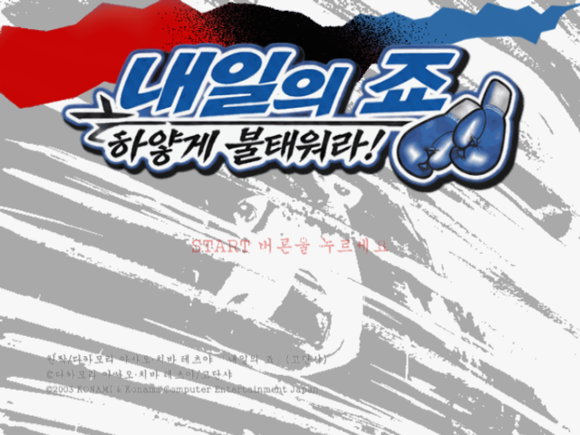
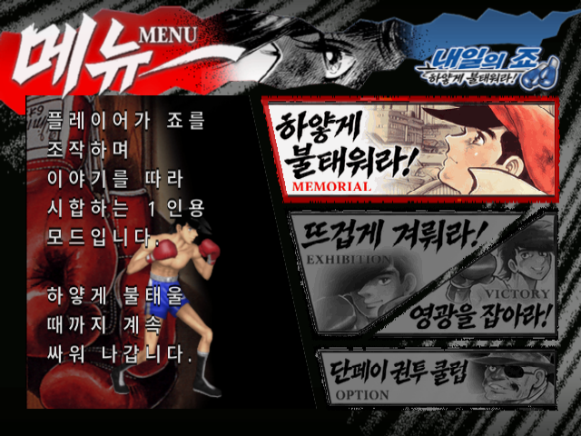
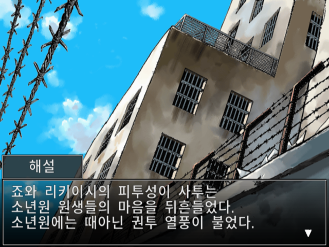
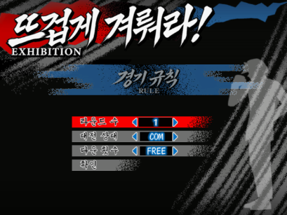
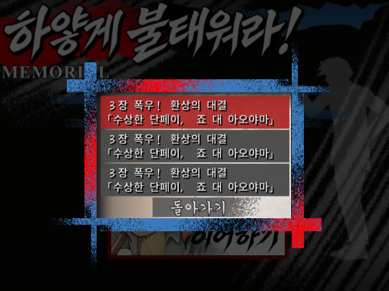

## 내일의 죠 PS2 한국어 패치 v0.95 TEST

**[배포 ZIP 다운로드](https://github.com/OldManCraveGuitars-bit/PS2-Ashita-no-Joe-Masshiro-ni-Moe-Tsukiro-Kr/releases/download/v0.95/Ashita-no-Joe-Kr-v0.95.zip)**

ZIP에는 **Windows용 전용 EXE 패처**, 차분 파일, 해시 검사 정보와 적용 안내가 들어 있습니다. Python 설치는 필요 없습니다. 원본 ISO는 포함하지 않습니다.

### 적용 방법

1. `Ashita-no-Joe-Kr-v0.95.zip`의 압축을 모두 풉니다.
2. `Ashita-no-Joe-Kr-Patcher-v0.95.exe`를 실행합니다.
3. 일본판 원본 ISO와 새 한글 ISO 저장 위치를 선택하고 **한글 패치 적용**을 누릅니다.
4. 완료 후 생성된 ISO를 새로 부팅합니다.

대상은 일본판 **SLPM-65441**, 원본 크기는 **2,196,439,040 bytes**입니다. EXE·패치·manifest를 같은 폴더에 두세요. 약 2.5GB의 출력 공간이 필요하며 기존 파일은 덮어쓰지 않습니다.

### 반영 내용

- 대사 3,289개·시스템 554개, 메인·UI·경기 표시 이미지 617개.
- 영상 51개에 자막 318개, 원본 음성 유지.
- 원작 붓글씨·색·종이 질감·삽화를 유지한 한글 UI와 반각 띄어쓰기.
- 장 시작·챕터 제목, 대전 소개·별명·제1~15라운드와 튜토리얼 보완.
- 저장 프리징·긴 제목 넘침, START 잘림, 화살표 위치, ㅇ 안팎 테두리 보완.
- 경기 규칙·재대결/종료의 위치·잘림·위아래 잔상 수정.
- 오프닝 제목 자막과 ‘땡―!’, ‘땡!’ 종소리 글씨 연출 추가.

[전체 수정 내역](https://github.com/OldManCraveGuitars-bit/PS2-Ashita-no-Joe-Masshiro-ni-Moe-Tsukiro-Kr/blob/v0.95/CHANGELOG.md)

### 스크린샷

| 메인 | 스토리 |
| --- | --- |
|  |  |

| 경기 규칙 | 저장 목록 |
| --- | --- |
|  |  |

### SHA-256

배포 ZIP:

```text
4759606979202ca1462e79ad60d2b9428ade18f0e71cbf9919b9588b8d146e12
```

일본판 원본 ISO:

```text
7a03d9515210cdf97d9d96cbd4cfa06805b5807fbc5259f3c9e93be28b7245b8
```

v0.95 적용 결과 ISO:

```text
8371802c869787c82fa30e34bb7f02629d35a9d288d76ad162b6c9f7644920e7
```

EXE로 원본 ISO에 실제 적용하여 결과 해시가 일치하는 것을 확인했습니다. [EXE·차분 패치 해시와 검사 기록](https://github.com/OldManCraveGuitars-bit/PS2-Ashita-no-Joe-Masshiro-ni-Moe-Tsukiro-Kr/blob/v0.95/docs/HASHES.md)

전체 플레이·모든 음성 직접 청취·PS2 실기 검증은 완료하지 않아 TEST로 배포합니다. [검증 범위](https://github.com/OldManCraveGuitars-bit/PS2-Ashita-no-Joe-Masshiro-ni-Moe-Tsukiro-Kr/blob/v0.95/docs/VALIDATION.md)
