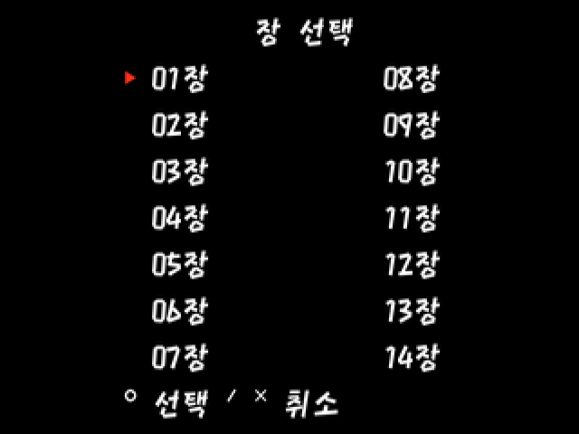
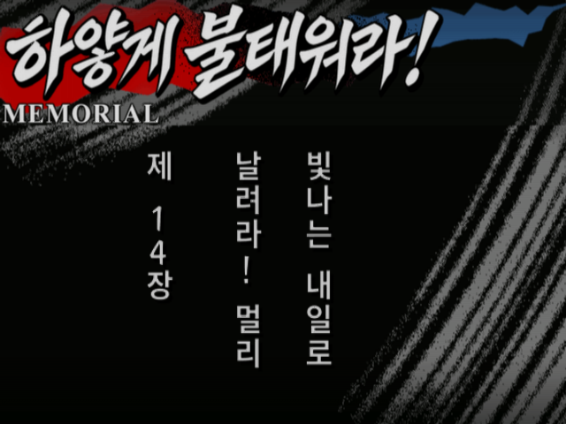
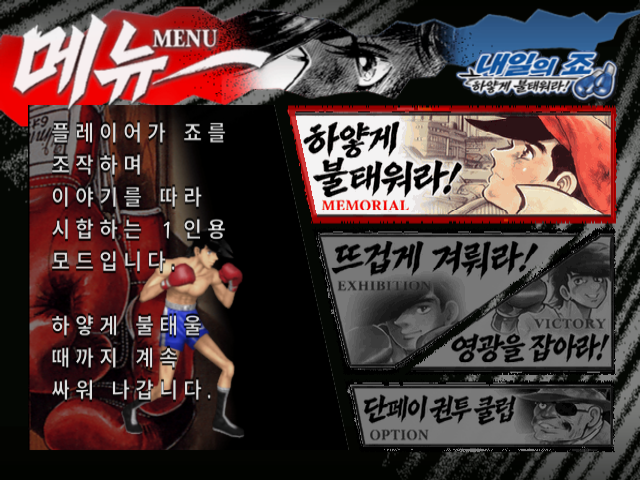
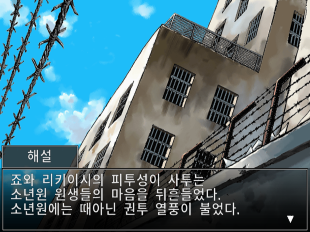
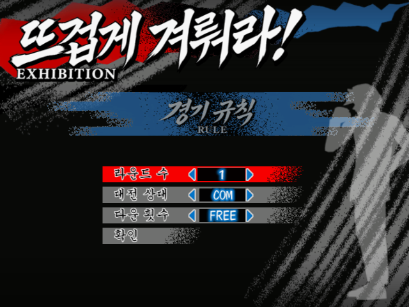
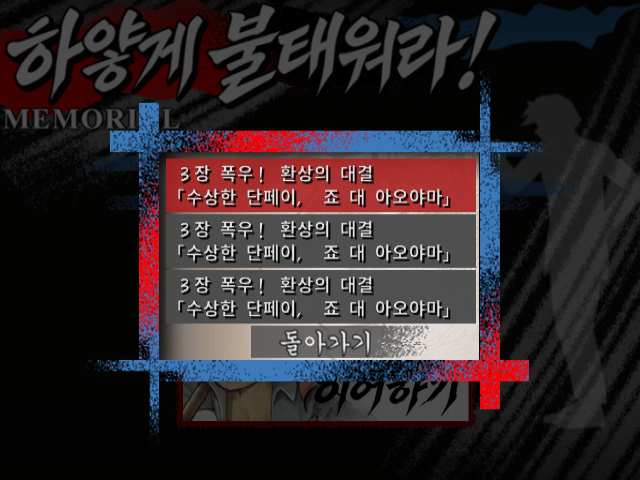
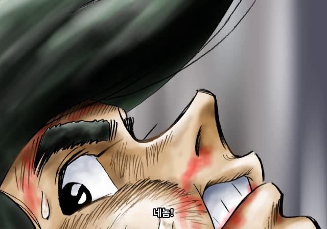
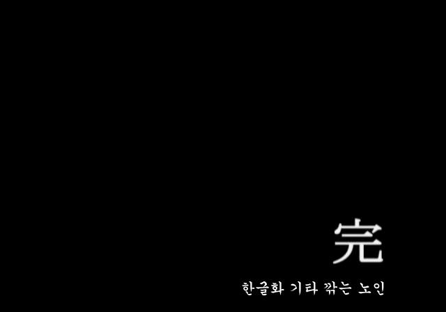

## 내일의 죠 PS2 — 비공식 한글화 정식버전 v1.1

**한글화: 기타 깎는 노인**

**[전용 EXE 패치 ZIP](https://github.com/OldManCraveGuitars-bit/PS2-Ashita-no-Joe-Masshiro-ni-Moe-Tsukiro-Kr/releases/download/v1.1/Ashita-no-Joe-Kr-v1.1.zip)** · **[전체 챕터 개방 세이브](https://github.com/OldManCraveGuitars-bit/PS2-Ashita-no-Joe-Masshiro-ni-Moe-Tsukiro-Kr/releases/download/v1.1/Ashita-no-Joe-Kr-All-Chapters-v1.1.zip)** · [해시 목록](https://github.com/OldManCraveGuitars-bit/PS2-Ashita-no-Joe-Masshiro-ni-Moe-Tsukiro-Kr/blob/v1.1/docs/HASHES.md)

### v0.95 이후 추가된 기능·수정

- **SELECT 장 이동**: 일반 스토리 대사 화면에서 SELECT → 제1~14장 시작 지점 선택. 방향키 선택, **○ 이동 / ×·SELECT 취소**입니다. 전투·영상·장면 전환·기존 일시정지·저장 창에서는 동작하지 않습니다. 이동 전 진행은 자동 저장되지 않습니다.
- **전체 챕터 개방 세이브**: 기존 챕터 메뉴의 143개 항목을 개방했습니다. `.ps2` 카드와 `.psu` 가져오기 파일을 제공합니다. 14개 장 시작을 고르는 SELECT 메뉴와 구분하며, 새 기능에 세이브 파일이 필수인 것은 아닙니다.
- 리키이시 등 등장인물의 반말·존대를 상대와 문맥에 따라 재검수했습니다.
- 긴 제목·시합 조건의 잘림을 보완하고 챕터/저장 제목의 (1), (2) 괄호를 제거했습니다.
- 카를로스 출국 장면과 죠의 짧은 호칭 등 보이스 자막 누락을 보완했습니다. 곤도 비명의 ‘울프!’ 오인식 자막은 삭제했습니다.
- 원래 엔딩 크레딧·삽화·完을 유지하고 마지막 아래에 **‘한글화 기타 깎는 노인’** 한 줄만 추가했습니다.

대사 3,289개, 시스템 554개, 한글 이미지 617개, 자막 영상 52개·총 337개 항목(음성·노래 335 + 엔딩 표기 2)을 반영합니다. v0.95의 UI·반각 띄어쓰기·라운드·종소리·저장 프리징 수정도 포함합니다.

### 패치 적용

1. `Ashita-no-Joe-Kr-v1.1.zip`의 압축을 모두 풉니다.
2. Windows에서 `Ashita-no-Joe-Kr-Patcher-v1.1.exe`를 실행합니다. Python 설치는 필요 없습니다.
3. **일본판 원본 SLPM-65441 ISO**와 새 한글 ISO 저장 위치를 선택하고 적용합니다.
4. 원본·차분·출력 SHA-256 검사 완료 후 `Ashita-no-Joe-Kr-v1.1.iso`를 새로 부팅합니다.

v0.95 사용자도 일본판 원본에서 다시 패치하세요. EXE·차분·manifest는 같은 폴더에 둡니다. 출력 ISO용 약 3GB의 여유 공간이 필요합니다. 처음에는 이전 savestate의 자동 불러오기를 끄세요. 원본 ISO와 BIOS는 포함하지 않습니다.

### 세이브 적용

기존 카드를 먼저 백업한 뒤 `.ps2`를 별도 카드로 연결하거나 `.psu`를 기존 카드에 가져옵니다. 패치 ZIP의 `saves` 폴더에도 같은 파일이 들어 있습니다. [PCSX2 계열·RetroArch 적용 안내](https://github.com/OldManCraveGuitars-bit/PS2-Ashita-no-Joe-Masshiro-ni-Moe-Tsukiro-Kr/blob/v1.1/docs/SAVE-GUIDE.md)

이전에 사용하던 RetroArch/LRPS2 기존 카드 방식의 예시는 `내부 저장소/RetroArch/system/pcsx2/memcards/Mcd001.ps2`입니다. 시스템 폴더·코어·게임별 카드 설정이 다르면 해당 설정을 우선하세요.

### 스크린샷

| 새 SELECT 메뉴 | 이동 후 제14장 |
| --- | --- |
|  |  |

| 메인 메뉴 | 스토리 대사 |
| --- | --- |
|  |  |

| 경기 규칙 | 저장 목록 |
| --- | --- |
|  |  |

| 보이스 자막 — 최종 영상 프레임 | 엔딩 한글화 표기 — 최종 영상 프레임 |
| --- | --- |
|  |  |

[전체 화면·추가 설명](https://github.com/OldManCraveGuitars-bit/PS2-Ashita-no-Joe-Masshiro-ni-Moe-Tsukiro-Kr/blob/v1.1/README.md) · [화면 출처와 검증 범위](https://github.com/OldManCraveGuitars-bit/PS2-Ashita-no-Joe-Masshiro-ni-Moe-Tsukiro-Kr/blob/v1.1/docs/VALIDATION.md)

### SHA-256

패치 ZIP:

```text
67c10b1e92d22324ab81f983244da5756e0199e44310b6a57800269702aaa177
```

일본판 원본 ISO (2,196,439,040 bytes):

```text
7a03d9515210cdf97d9d96cbd4cfa06805b5807fbc5259f3c9e93be28b7245b8
```

v1.1 결과 ISO (2,527,619,072 bytes):

```text
32ae998430c4435d424479f417d6a4e57b9f624fcc0ca6741fd979888b0aaf30
```

### 검증 범위

전용 EXE로 원본에 실제 패치하여 결과 해시가 일치하는 것을 확인했습니다. 14개 장 시작·19회 반복 이동, 호출 조건 등 명령 실행 39개 사례, 카드 개방 판정 286회와 데이터·영상·원본 음성 보존 검사를 통과했습니다. PC 기능 검사는 디버거로 입력·장면을 준비한 검사입니다.

정식 배포 릴리스이며, 전편 완주·전체 음성 직접 청취·PS2 실기·모든 기기 조합은 미검증입니다. 새 장 이동 뒤 메모리카드 저장 완료까지의 전체 흐름과 개방 카드의 메뉴 전체 탐색도 미완료입니다. [상세 검증 기록](https://github.com/OldManCraveGuitars-bit/PS2-Ashita-no-Joe-Masshiro-ni-Moe-Tsukiro-Kr/blob/v1.1/docs/VALIDATION.md)

[전체 변경 내역](https://github.com/OldManCraveGuitars-bit/PS2-Ashita-no-Joe-Masshiro-ni-Moe-Tsukiro-Kr/blob/v1.1/CHANGELOG.md)
